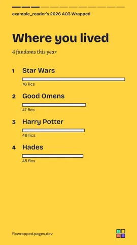
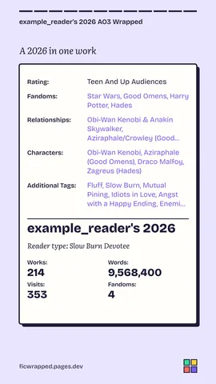

# FicWrapped: AO3 Wrapped 2026 without your password

**FicWrapped is a free, open-source AO3 Wrapped. It turns your Archive of Our Own History into Spotify-Wrapped-style cards inside your own browser. It never asks for your AO3 password and uploads nothing.** Try it at **https://ficwrapped.pages.dev/**.

AO3 Wrapped is a fan-made year in review of your reading on Archive of Our Own (AO3). As of November 2026, AO3 has no official one.

<p>



</p>

## Quick start

1. Open https://ficwrapped.pages.dev/ and drag the **✦ AO3 Wrapped** button to your bookmarks bar. Phone steps: https://ficwrapped.pages.dev/ao3-wrapped-on-phone/
2. Open archiveofourown.org while logged in and click the bookmark.
3. Click **Read my History**. It reads your History pages (25 works each, about one page a second).
4. Click **Open my Wrapped**, then save or share your cards.
5. Rather not run code on AO3? Paste your History pages into the site instead.

## Ways to make an AO3 Wrapped, compared (checked 25 November 2026)

| Method | Needs your AO3 password or cookie? | Where it runs | Works on a phone | What the tool's owner can see |
|---|---|---|---|---|
| Website that logs in for you | Yes | Their server | Yes | Everything your account can see |
| Colab notebook | Usually username + password, or a session cookie | Google's servers | Awkward | Depends on the code |
| Browser extension | No | Your browser | Only where extensions run (e.g. Firefox for Android) | Whatever its permissions allow |
| Bookmarklet (FicWrapped) | No | Your own AO3 tab | Yes | Nothing |
| Paste History pages (FicWrapped) | No | The FicWrapped page | Yes | Only what you paste |

## How it works

1. The bookmarklet loads [`c.js`](src/c.js) on archiveofourown.org.
2. `c.js` fetches only `/users/<you>/readings?page=N` (plus `?show=to-read` if you ask for Marked for Later), about one page every 1.1 seconds, and stops at the start of the chosen year. It waits when AO3 answers 429 / "Retry later".
3. [`core.js`](public/core.js) parses each History entry: title, authors, fandoms, rating, categories, warnings, relationships, characters, additional tags, words, chapters, kudos, hits, last visited date and visit count.
4. You click **Open my Wrapped**; the list goes to the FicWrapped tab with `postMessage` (origin-checked both ways). No server receives it.
5. [`cards.js`](public/cards.js) draws up to twelve 1080×1920 cards on a canvas: totals, top fandoms, ships, characters, tags, ratings, most-visited fic, longest fic, months, reader type and a summary card.

## What the numbers mean

| | |
|---|---|
| Year | A work counts for 2026 if you **last** visited it in 2026. AO3 stores only the most recent visit date. |
| Fics | Each work once. Opened, not necessarily finished. |
| Words | The work's full word count. |
| Visits | AO3's "Visited N times" counter. |
| Reading time | Words ÷ 250 per minute. |

## FAQ

- **Is there an official AO3 Wrapped?** No. Every AO3 Wrapped is fan-made from your AO3 History.
- **Does it need my password?** No. You log in to AO3 yourself; the bookmark runs in that tab and passes the list to the FicWrapped tab.
- **Does it work on a phone?** Yes: Safari and Chrome bookmarks, or paste mode. https://ficwrapped.pages.dev/ao3-wrapped-on-phone/
- **Can I make last year's?** Partly. AO3 keeps only the last visit date, so fics you reopened this year have moved. https://ficwrapped.pages.dev/ao3-wrapped-2025/
- **Is it safe?** What each kind of tool can see: https://ficwrapped.pages.dev/is-ao3-wrapped-safe/

## Supporter Pack

The Wrapped is free. An optional $3.99 Supporter Pack (Dodo Payments; the license key is checked by the Pages Function in `functions/api/license.js`) adds a printable A4 poster (PDF/PNG), cards without the web address, and a CSV plus a searchable offline page of your loaded History.

## Development

```
python3 build.py https://ficwrapped.pages.dev/ pdt_PRODUCTID   # writes public/
node test/core.test.js                                          # parser + stats
NODE_PATH=$(npm root -g) node test/e2e.js                       # bookmarklet against a mocked AO3 (Playwright)
```

Copy, FAQ and guide pages live in `src/content.py`. Cloudflare Pages: no build command, output directory `public`. MIT license.

By [yesyanyan](https://www.tumblr.com/yesyanyan) (YanSquared), who also makes [FicToEpub](https://fictoepub.pages.dev/), the free AO3 HTML to EPUB converter. Not affiliated with the Organization for Transformative Works or the Archive of Our Own. Contact: hello@yansquared.com
